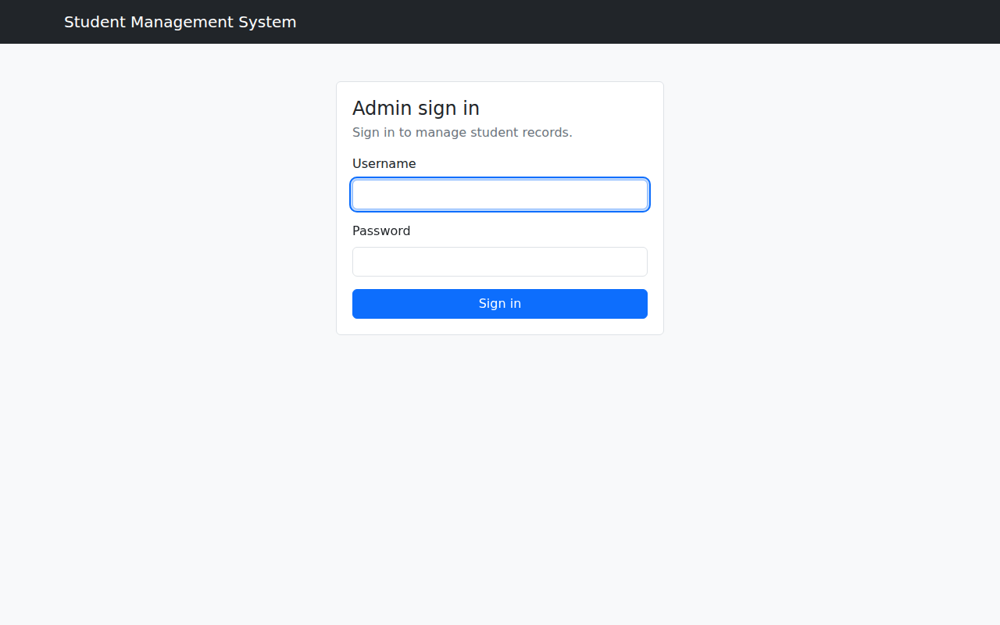
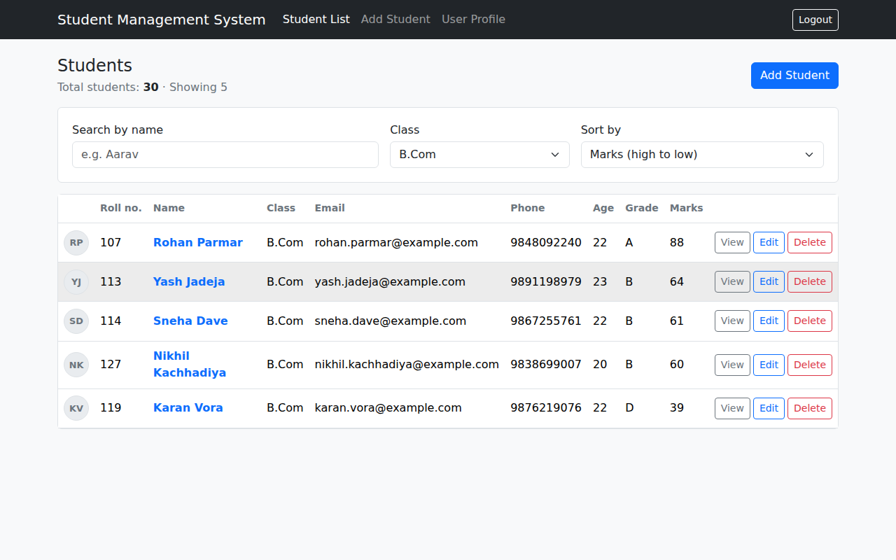
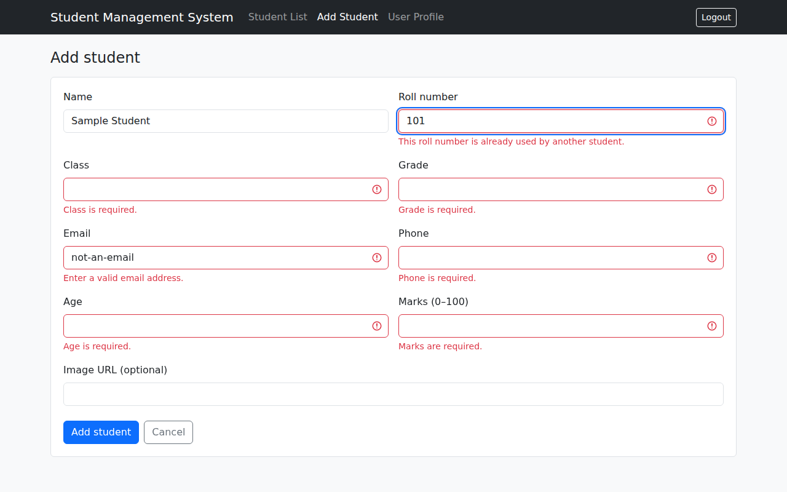

# Student Management System

A minimal, responsive React application for managing student records. Built with React, Redux, Redux Thunk,
React Router DOM, Bootstrap and JSON Server. An administrator can sign in, then view, add, edit and delete
students, search by name, filter by class and sort by name, roll number or marks.

## Screenshots

**1. Admin login**



**2. Student list** (class filter and marks sort applied together)



**3. Add student** (inline validation feedback)



## Features

- Admin login and logout; student pages are protected and unauthenticated users are redirected to Login
- Student list loaded from JSON Server through Redux Thunk, with loading, error and empty states
- Add, edit and delete students (delete asks for confirmation); changes persist in `db.json`
- Name search (case-insensitive, partial), class filter and sorting, usable together
- Validation for required fields, email, numeric age and marks, and unique roll number (client and server)
- Responsive Bootstrap layout and navbar

## Tech stack

React (Create React App), React Router DOM, Redux / React Redux, Redux Thunk, JSON Server, Axios, Bootstrap 5

## Getting started

```bash
npm install
npm run dev        # API on http://localhost:3001 and app on http://localhost:3000
```

Or run them separately in two terminals:

```bash
npm run server
npm start
```

Default admin login: **admin / Admin@123**. Change it with:

```bash
npm run set-admin -- <username> <password>
```

## Using your own student data

`db.json` ships with 30 placeholder students. Replace it with your own file (it needs a top-level `students`
array). The app never overwrites or re-seeds it. Expected fields: `id, name, rollNumber, class, phone, email,
age, grade, marks, image`. If your schema differs, update `FIELDS` in `src/components/StudentForm.jsx`, the table
in `src/pages/StudentList.jsx`, and `validateStudent` in `server/index.js` and `src/utils/validation.js`.

## Routes

| Route | Access |
| --- | --- |
| `/login` | Public |
| `/students` | Authenticated |
| `/students/add` | Authenticated |
| `/students/:id` | Authenticated |
| `/students/:id/edit` | Authenticated |
| `/profile` | Authenticated |

## API

| Method | Endpoint | Operation |
| --- | --- | --- |
| POST | `/auth/login` | Sign in, returns a session token |
| GET | `/students` | Fetch all students |
| GET | `/students/:id` | Fetch one student |
| POST | `/students` | Add a student |
| PUT | `/students/:id` | Update a student |
| DELETE | `/students/:id` | Delete a student |

All `/students` requests need an `Authorization: Bearer <token>` header.

## Project structure

```
db.json                     Student data (JSON Server)
server/index.js             JSON Server + login, token check, server-side validation
server/admin.json           Hashed admin credentials (kept out of db.json)
scripts/set-admin.js        Creates or changes the admin account
src/
  app/store.js              Redux store
  api/client.js             Axios instance with auth header
  components/               Navbar, ProtectedRoute, StudentDetails, StudentForm, StudentRow, ConfirmDialog
  pages/                    Login, StudentList, UserProfile
  redux/actions|reducers|thunks
  utils/                    Validation, filtering and sorting, session, error messages
```

## Authentication note

JSON Server has no authentication of its own, so `server/index.js` wraps it: the admin password is stored as a
salted hash in `server/admin.json`, login returns an expiring signed token, and every `/students` endpoint rejects
requests without a valid token. After 5 failed logins the API blocks further attempts for a minute.

## Configuration

`REACT_APP_API_URL` (default `http://localhost:3001`). Server environment variables: `PORT`, `CLIENT_ORIGIN`,
`AUTH_SECRET`.
